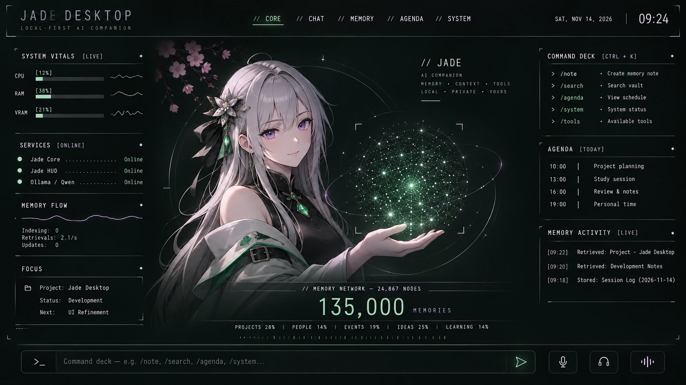

# Jade Desktop

**A local-first AI companion — built with privacy, thoughtful design, and security-minded engineering.**

*Public development showcase · Windows-first, Linux-ready · November 2026*

> **Status:** A working Windows **development** desktop has been demonstrated with Tauri, React, a Python backend, and local Ollama/Qwen chat. It is **not** a packaged or security-hardened release. Private memory access remains disabled.

## Meet Jade

Jade Desktop is an independent personal project exploring how to build an approachable AI companion while keeping its owner in control. The long-term vision combines local conversation, a polished desktop interface, a Live2D character, and selectively authorized access to personal knowledge and tools.

This repository is a **public portfolio**, not the application source or a downloadable release.



*Design concept — not a screenshot of the working app. The pictured memory data, commands, vitals, and agenda are illustrative; private memory remains disabled.*

[Explore Jade's visual evolution →](docs/GALLERY.md)

## Progress at a glance

| Capability | Status |
| --- | --- |
| Native Windows development window | Demonstrated |
| React desktop interface | Demonstrated |
| App-managed Python backend startup/shutdown | Demonstrated in development |
| Local Ollama / Qwen conversation | Demonstrated in development |
| Authenticated production desktop/backend IPC | Research and validation in progress |
| Private Obsidian memory access | **Disabled** pending security and permission gates |
| Windows packaged distribution | Planned |
| Linux validation | Planned |
| Live2D Jade and polished companion HUD | Planned |

**Demonstrated** means observed in a development setup, not production-ready or independently audited.

## Technology

- **Desktop:** Tauri / Rust
- **Interface:** React / TypeScript
- **Core:** Python / FastAPI
- **Local model:** Ollama / Qwen
- **Future knowledge integration:** permission-scoped Markdown / Obsidian
- **Future character:** Live2D

## Engineering values

Jade's engineering approach combines **local-first design**, **Zero Trust Architecture**, **defense in depth**, **least privilege**, **secure-by-design defaults**, and **evidence-based security testing**. These are guiding principles, not claims that all protections are already implemented.

| Principle or method | What it means for Jade | Current standing |
| --- | --- | --- |
| **Zero Trust Architecture** | Verify identities and authorize each sensitive operation; do not trust a connection merely because it is local. | Design principle; production enforcement unverified |
| **Least privilege & default deny** | Grant only necessary capabilities, data scope and duration; deny private memory by default. | Memory default-deny demonstrated; broader controls planned |
| **Defense in depth & component isolation** | Maintain multiple independent boundaries between UI, Core, model, tools and personal data. | Architecture goal; OS isolation testing blocked |
| **Authenticated IPC & peer identity** | Validate the communicating service/process and its live instance instead of trusting localhost or a PID alone. | Synthetic experiments; production validation pending |
| **Secure credential handling & lifecycle controls** | Protect credentials, minimize exposure, and design for revocation, restart and recovery. | Planned and under review |
| **Input validation & anti-exploitation hardening** | Restrict accepted operations and data; use bounded messages, safe defaults and independently enforced permissions. | Selected synthetic tests; broader hardening planned |
| **Prompt-injection resistance** | Treat retrieved notes, model responses and future external content as untrusted; never let content grant itself tool permissions. | Threat-model requirement; adversarial validation planned |
| **Human authorization & consent** | Require explicit, narrowly scoped approval before private data is read or sent into model context. | Private access disabled; consent workflow planned |
| **Security testing & responsible disclosure** | Use synthetic fixtures, negative tests, documented limitations and private remediation before public summaries. | Active development practice |
| **Portability & maintainability** | Keep shared logic independent of Windows/Linux-specific security adapters. | Architectural direction |

We use the **MITRE ATT&CK**, **MITRE ATLAS** and **MITRE CWE** knowledge bases to inform threat reviews, including AI-specific threats. They are **reference frameworks**, not proof that Jade has mitigated every listed technique.

Read the [security terminology, review process and implementation-status notes](docs/SECURITY_APPROACH.md). We share defensive lessons at a high level, without publishing exploit recipes, bypass details, or sensitive test configurations.

## Project organization

Jade Desktop is developed with clearly defined responsibilities and owner-controlled decisions.

| Role | Identity | Responsibility |
| --- | --- | --- |
| **Project Owner (You)** | Project Lead | Set the vision, priorities, and requirements. Approve merges, sensitive operations, and major decisions. |
| **Sage — Technical Advisor** | Technical Architect, Security Reviewer & Objective QA | Plan architecture, review code, identify security risks, maintain roadmap priorities, advise on decisions, and independently assess implementation evidence, test quality, and Sage's own recommendations. |
| **Emerald — Coding Agent** | Lead Developer | Implement features, write tests, investigate bugs, prepare pull requests, and report progress for review. |
| **Jade — AI Companion** | The Product | The independent, local-first AI companion under development, with planned conversation, memory, voice, and authorized integrations. |

**Independent decision challenge:** Sage also respectfully challenges the project owner's decisions when evidence, security, feasibility, or roadmap priorities warrant it, explaining trade-offs and alternatives while preserving the owner's final decision authority.

### Team workflow

```text
               Project Owner (You)
                Decide and authorize
                         |
               +---------+---------+
               |                   |
              Sage               Emerald
       Architecture, review    Development, tests
          and security         and pull requests
               |                   |
               +---------+---------+
                         |
                         v
                        Jade
                AI Companion (Product)
```

**Decision authority:** The project owner retains final approval. Sage reviews and advises; Emerald implements and tests. Jade is the product being developed, not an independent approval authority.

## Explore the project

- [Project vision](docs/PROJECT_OVERVIEW.md)
- [Development milestones](docs/PROGRESS.md)
- [Architecture overview](docs/ARCHITECTURE.md)
- [Security and privacy approach](docs/SECURITY_APPROACH.md)
- [Visual direction](docs/VISUAL_DIRECTION.md)

## Visual direction

Jade's character concept features silver-white hair, violet eyes, jade-green botanical accents, and a dark outfit with a light jacket. The interface direction favors a readable dark HUD with restrained mint and violet highlights.

Concept art is **not** the same as a finished, integrated Live2D model. A reviewed screenshot and artwork gallery can be added later.

---

*This public showcase intentionally excludes private notes, credentials, sensitive implementation details, and unreviewed development screenshots.*
