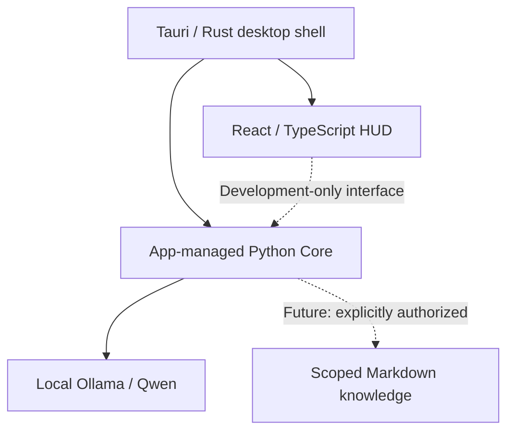

# Architecture overview

The native shell, UI, backend, and model runtime are separate concerns. The diagram describes the **development composition** and proposed future boundary, not a hardened production data flow.

## Platform strategy

Windows development comes first. Shared schemas, application logic, and authorization contracts should remain portable; Windows and Linux will require independently validated OS-specific IPC and identity adapters.

## Security boundary

Localhost, a process ID, or a shared user account alone do not prove a trustworthy peer. Production IPC authentication, operating-system isolation, authorization, replay protection, and safe packaging are open milestones.

Private memory access remains disabled until separate security review and owner permission.
