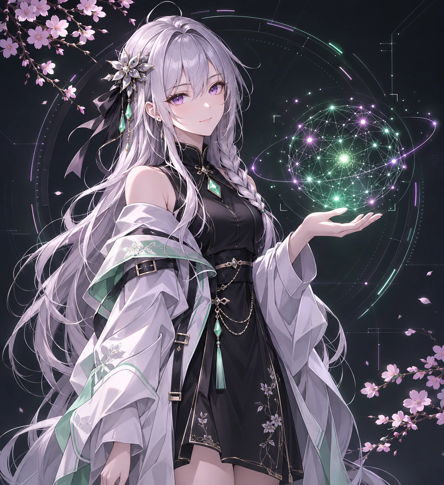
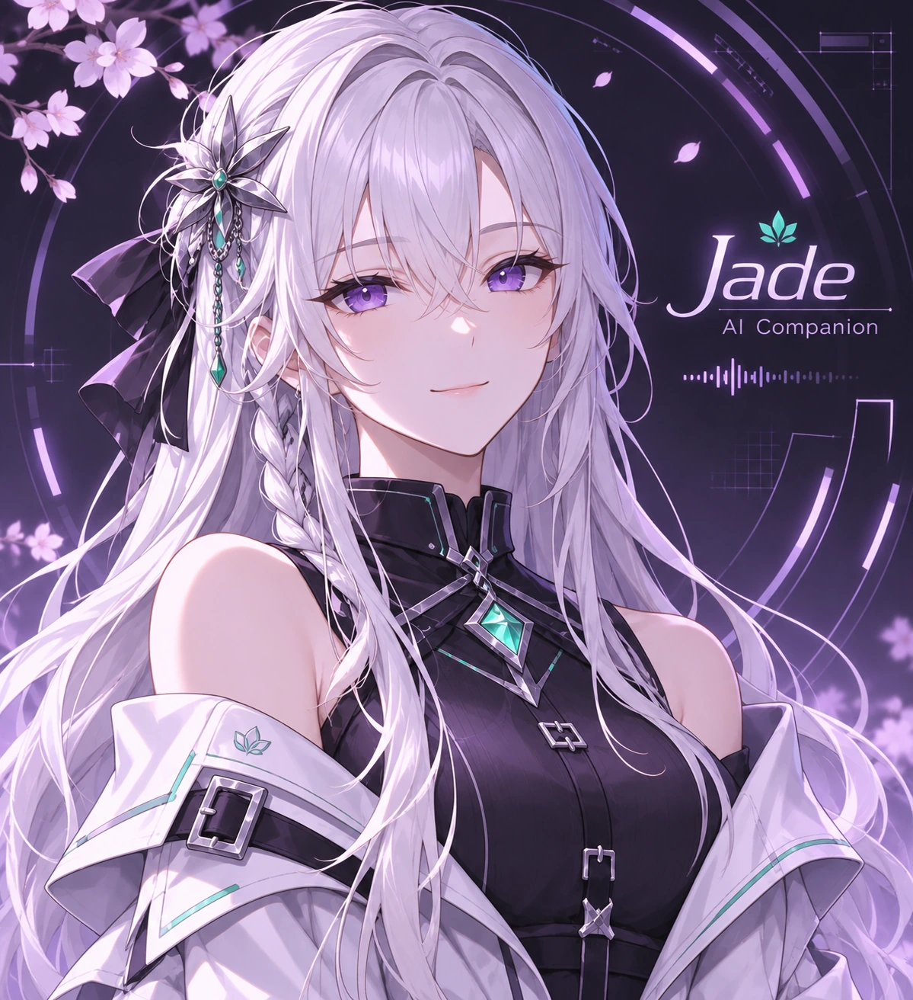
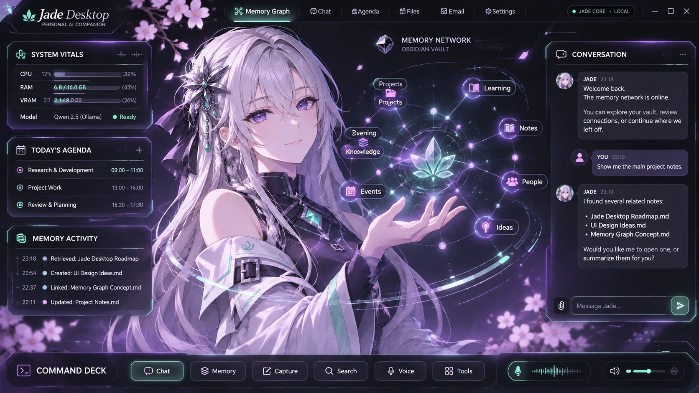
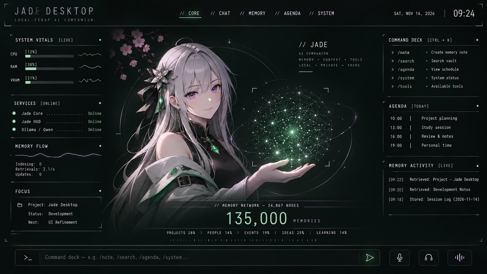

# Jade Desktop — visual evolution

These images were selected by the project owner as **concept artwork**. They illustrate Jade's character and HUD design evolution; **none is a screenshot of the running application**.

## Character concepts

### Jade — Sakura Holographic Network

Character-focused visual direction featuring cherry blossoms and jade-green holographic details. It is not the running Live2D avatar.

### Jade — original character concept

Earlier character art establishing Jade's silver-white hair, violet eyes, floral ornament and signature colors.

## HUD concept evolution

### Version 1 — Memory Network Dashboard (earlier)

An early exploration of a companion-centered interface and memory-network visualization.

### Version 2 — Memory Orb Interface (current preferred HUD direction)

The newer direction, also featured in the [showcase README](../README.md): refined dark surfaces, restrained mint and violet highlights, a clearer command deck, system status, agenda, and Jade as the focal point.

## Illustrations are not working features

The artwork includes example system vitals, memory graphs and counts, retrieval activity, vault commands, agenda, audio controls, and service statuses. These are **illustrative only** and do **not** establish that the depicted features are implemented or available. Real private memory access remains **disabled** pending explicit permission and security verification.

A separately labelled screenshot of the **actual Windows development app** may be added later, only after privacy review.

## Publication and attribution

The showcase uses web-optimized copies of the original images supplied by the project owner. Source pictures are preserved separately. All linked assets above have been committed to the repository under `assets/`.

No private notes, credentials, machine paths, unredacted logs or personal desktop contents should be included in the public gallery.
